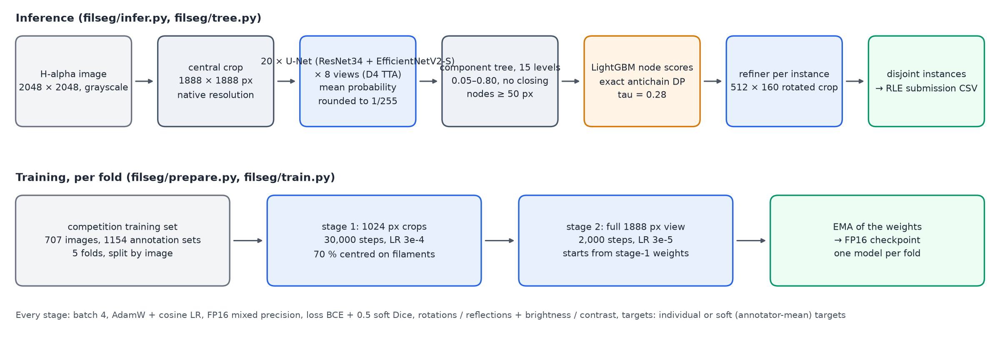

# Solar filament instance segmentation (Kaggle 2026)

Our solution to the *Solar Filament Segmentation Challenge 2026*: every solar
filament in a 2048×2048 H-alpha full-disk image is returned as a separate,
non-overlapping mask in the competition's submission format.

The method is deliberately simple: an ensemble of 20 U-Nets (five with a ResNet34
encoder trained on soft (annotator-averaged) targets, five with an EfficientNetV2-S
encoder, five with an EfficientNetV2-S encoder trained on soft (annotator-averaged)
targets, five with an EfficientNetV2-S encoder; one per cross-validation fold each)
predicts a filament probability for every pixel at native resolution, and a
post-processing step turns the probability map into instances. The trained weights are
included (37 weight files, 1539 MB in total, at most 45 MB per file (including the
refiner and the tree model)), so the submission is reproduced on a GPU or a CPU without
retraining and without network access.

This repository bundles two configurations that share most of their weights.
**P3 (the default)** is our primary submission: the four
families S, V, V_soft, V60k combined with staged quantization, a bagged
component tree (tau = 0.28) and a 10-model cross-fit
refiner. **P (the alternate)** is the
fallback: the families S, V, a single component tree
(tau = 0.26) and a 5-model refiner. Both use
the first-iteration deployment weights; `pipeline_config.json` holds the
default and `configs/P.json` the alternate, and
`weights/manifest.json` records which configuration uses each file.



**Contents:** [Results](#results) ·
[Reproduce the submission](#reproduce-the-submission) ·
[How the pipeline works](#how-the-pipeline-works) ·
[Reproduce the training](#reproduce-the-training) ·
[Limitations](#limitations) · [Repository layout](#repository-layout) ·
[Sources](#sources-and-acknowledgements) · [License](#license)

## Results

Scores of the default configuration P3 (cross-validated PQ is
the primary metric; the leaderboard value is a sanity check only):

| Evaluation | PQ | SQ | RQ | TP | FP | FN |
|---|---:|---:|---:|---:|---:|---:|
| 5-fold cross-validation, out-of-fold, cross-fold post-processing (primary metric) | 0.4608 | 0.6836 | 0.674 | 5,169 | 1,970 | 3,030 |
| Public leaderboard, 180 test images (sanity check only) | 0.41 |  |  |  |  |  |

PQ = SQ × RQ, where SQ is the mean IoU of the matched instances and RQ = TP / (TP + FP/2
+ FN/2).


Scores of the alternate configuration P:

| Evaluation | PQ | SQ | RQ | TP | FP | FN |
|---|---:|---:|---:|---:|---:|---:|
| 5-fold cross-validation, out-of-fold, cross-fold post-processing (primary metric) | 0.4549 | 0.682 | 0.6671 | 5,179 | 2,150 | 3,020 |
| Public leaderboard, 180 test images (sanity check only) | 0.4 |  |  |  |  |  |

PQ = SQ × RQ, where SQ is the mean IoU of the matched instances and RQ = TP / (TP + FP/2
+ FN/2).

*Expected outputs.* On an NVIDIA GeForce RTX 3060 with the bundled FP16 weights, the 180
test images give, for P3, 1110 instances and `submission.csv` SHA-256
`6ce0bcfc5afdcc3dc0bd88886287e18017d9407de62e0df850ad0488c6eb467a` (public leaderboard
0.41). For P the SHA-256 is
`f4fce72fe54f088d9f7f3d433ff9ce7eb93ad52d12fe1108942703314cb76021` (public leaderboard
0.4). CPU (FP32) runs differ from the GPU run only in boundary pixels; the instance
counts agree. *Validation protocol.* The 707 training images are split into 5 folds by
image (`folds.csv`), so the one to three independent annotations of an image never
straddle training and validation; the folds are balanced by year, observatory and number
of annotators. Every fold model is scored only on the images it did not see
(out-of-fold). As in the official evaluation, each annotator's label set of an image is
a separate entry and PQ is accumulated over all entries. The post-processing parameters
of fold *k* were chosen on the other four folds only ("cross-fold"); the parameters used
for the test set are the best ones on all out-of-fold predictions.

The public leaderboard served only as a sanity check. The test images belong
to the public MAGFiLO release, so very high leaderboard scores are reachable
only through leaked labels; we used no annotations besides the competition's
training file and no model trained on MAGFiLO.

## Reproduce the submission

**1. Install** (Python 3.12):

```bash
git clone https://github.com/Aero123421/filament-segmentation-2026.git
cd filament-segmentation-2026
python3.12 -m venv .venv
source .venv/bin/activate
python -m pip install torch==2.11.0 torchvision==0.26.0 --index-url https://download.pytorch.org/whl/cu128
python -m pip install -r requirements.txt
python -m ipykernel install --sys-prefix --name filseg --display-name 'Python (filseg)'
```

The CUDA 12.8 wheels above reproduce the tested GPU environment (Linux,
Python 3.12, RTX 3060). A compatible NVIDIA driver is required. For a CPU-only
machine, replace the PyTorch index URL with `https://download.pytorch.org/whl/cpu`;
CPU inference uses FP32 and does not reproduce the GPU CSV byte for byte.

**2. Check the weights.** All 37 model files are committed directly in
`weights/` as ordinary Git files (1,538.6 MB total, each below 50 MB).
Cloning the repository includes every weight; Git LFS, Release downloads
and retraining are unnecessary. Verify SHA-256 and size (standard library only):

```bash
python fetch_weights.py            # all bundled configurations
python fetch_weights.py --config P3   # only the default's files
```

**3. Add the data:** copy the 180 test JPEGs to `test_images/` (or set
`FILSEG_TEST_DIR` to their folder).

**4. Run** `notebooks/pipeline.ipynb` from top to bottom, or headless:

```bash
FILSEG_TEST_DIR=/path/to/test_images \
  jupyter nbconvert --to notebook --execute notebooks/pipeline.ipynb \
    --ExecutePreprocessor.kernel_name=filseg --ExecutePreprocessor.timeout=-1 \
    --output pipeline_executed.ipynb
```

The notebook runs the default configuration P3. To reproduce
the alternate instead, set `FILSEG_CONFIG=P` (it reads
`configs/P.json`); `FILSEG_CONFIG` with no value in this
list is an error. The notebook verifies the weight checksums, walks
through every step on one image, writes `submission.csv` (and
`submission.csv.timing.json`), checks the file format and shows example
predictions. Optional environment variables: `FILSEG_OUTPUT_CSV` (output
path), `FILSEG_DEVICE` (`cuda` or `cpu`; default: CUDA if available),
`FILSEG_LIMIT` (only the first *N* images, for a quick check) and
`FILSEG_THREADS` (CPU threads; default: 1). The notebook fixes seeds to 0,
disables TF32 and cuDNN benchmarking, and enables deterministic cuDNN,
matching the settings used for the expected CSV hashes. Keep the default
single thread and CUDA 12.8 environment for the byte-for-byte comparison.
It also records the CSV hash, inference timings and peak memory.

Run `python -m pytest` for the CPU checks. One optional test skips without
research probability maps; those maps are unnecessary for inference.
Notebook outputs are intentionally cleared in Git because execution displays
competition images. Executed notebooks and generated CSVs stay local.

*Runtime* of this configuration (160 forward passes per image): 17.2 s per image on an
NVIDIA GeForce RTX 3060 (FP16), about 52 minutes for the 180 test images; peak GPU
memory 3.6 GB, peak host memory about 2.4 GB.

The same pipeline from Python:

```python
from filseg.infer import FilamentPipeline
from filseg.preprocess import read_image
from filseg.submission import labels_to_rows, write_submission

pipeline = FilamentPipeline.from_release(".")  # default: pipeline_config.json and weights/
result = pipeline.predict(read_image("test_images/20110120105534Ch.jpeg"))
write_submission(labels_to_rows("20110120105534Ch", result.labels), "one_image.csv")
```


For the alternate configuration, load `configs/P.json`
instead (`FilamentPipeline(PipelineConfig.from_json("configs/P.json"),
"weights")`); the weights directory is shared.


## How the pipeline works

All settings below come from `pipeline_config.json` (the default
P3; the alternate is `configs/P.json`); the
code is in `filseg/`.

**1. Input** (`filseg/preprocess.py`). The JPEG is read as 8-bit grayscale. The
solar disk lies inside the central 1888×1888 square, so the network sees that
crop at native resolution: many filaments are only a few pixels wide, and in
our first experiments native resolution scored 0.009–0.023 PQ higher than
downscaled input. The 80-pixel border outside the crop is always background.

**2. Network** (`filseg/model.py`). The models are U-Nets with a ResNet34 encoder
trained on soft (annotator-averaged) targets (22.6 M parameters) and U-Nets with an
EfficientNetV2-S encoder (20.7 M parameters) and U-Nets with an EfficientNetV2-S encoder
trained on soft (annotator-averaged) targets (20.7 M parameters) and U-Nets with an
EfficientNetV2-S encoder (20.7 M parameters), built with segmentation-models-pytorch. It
has one input channel (the grayscale crop scaled to [0, 1]) and one output channel, the
filament logit of every pixel at full resolution; the encoder starts from ImageNet
weights and the decoder has 128-64-32-16-8 channels. One model per cross-validation fold
was trained on the other four folds, and all 20 are used at test time. Individual
targets use one annotator's masks per sample; soft targets average all annotators.

**3. Test-time augmentation and ensembling** (`filseg/infer.py`). Each model is applied
to the 8 rotations and reflections of the crop (the symmetries of the square, D4); the 8
probability maps are mapped back and averaged, and the 20 models are averaged with equal
weights: 160 forward passes per image. Filaments have no preferred orientation, so
averaging over views removes orientation-dependent errors (+0.008 to +0.012 PQ in our
cross-validation). Every view is an exact pixel permutation, so no interpolation is
involved. Each family's averaged map is then rounded to multiples of 1/255 on its own,
and the families are averaged in the uint8 domain and rounded once more (staged
quantization), exactly as in the stored out-of-fold maps on which the tree was tuned.

**4. From probabilities to instances** (`filseg/postprocess.py`,
`filseg/tree.py`).

1. **Component tree:** the probability map is thresholded at 15 levels (0.05 to 0.80);
   every 8-connected component of at least 50 px becomes a node, and components at
   successive levels form a nested forest (no closing, so nesting is exact).
2. **Learned scores:** a LightGBM regressor, refitted on all 707 training images and
   stored as a portable text model, predicts each node's expected IoU contribution from
   43 probability, shape and local-contrast features.
3. **Exact selection:** a dynamic program picks the disjoint set of nodes maximising the
   total predicted contribution minus 0.28 per instance (tau = 0.28); the picked nodes
   are the stage-1 instances.

Most false positives are faint, diffuse blobs, whereas real filaments have
a confident core; the learned node scores remove the former. Every pixel
gets at most one label, so instances never overlap.


**5. Refiner** (`filseg/refine/`). Each instance is cut out along its principal
axis into a 512×160 crop (image, probability, this instance, the other
instances) and re-segmented by a small U-Net; the refined masks replace the
stage-1 masks under fixed rules (refined probability > 0.4,
only components touching the instance, never deleting an instance). The
default averages 10 cross-fit refiners with 4-flip test-time
augmentation; the alternate averages 5.

**6. Submission file** (`filseg/submission.py`). One row per
instance: `filament_id` = `<image stem>_<k>` (largest instance first) and the
COCO run-length encoding of its 2048×2048 mask (pycocotools `counts` string).
Images without detections have no rows.

*Left out on purpose.* We adopted a change only if it raised cross-validated PQ by at
least 0.003 with a paired-bootstrap lower bound above zero. These ideas did not pass and
are not part of the pipeline: losses on the annotated filament spines (skeleton recall),
a 3-channel input with limb-darkening correction and CLAHE and re-joining fragments
along their direction.

## Reproduce the training

Optional: the weights in `weights/` are the result of these steps. Training
uses a CUDA GPU when available (a CPU works for short smoke runs) and the
competition's training data
(`MAGFiLO_1.0_Kaggle_2026/train`: `train_images/` and the annotation JSON).

**1. Build the training cache** (CPU, about 10 minutes, 1.6 GB): each image is
cropped to its central 1888×1888 square and stored with one mask per annotator.

```bash
python -m filseg.prepare --train-dir /path/to/MAGFiLO_1.0_Kaggle_2026/train --folds folds.csv --out prepared
```

**2. Train two stages per fold.** Stage 1 learns on 1024×1024 crops; stage 2 continues
from the stage-1 weights on the full 1888×1888 view at a lower learning rate, with the
sample stream continuing where stage 1 stopped (`--sample-offset` = stage-1 steps ×
batch 4). Both stages use AdamW, a cosine learning-rate decay, FP16 mixed precision, the
loss BCE + 0.5 × soft Dice and an exponential moving average of the weights, which is
what gets saved. The held-out fold is never used for training. The commands below
reproduce the bundled weights (five U-Nets with a ResNet34 encoder trained on soft
(annotator-averaged) targets; five U-Nets with an EfficientNetV2-S encoder; five U-Nets
with an EfficientNetV2-S encoder trained on soft (annotator-averaged) targets; five
U-Nets with an EfficientNetV2-S encoder; seed 20261103).

```bash
for FOLD in 0 1 2 3 4; do
  python -m filseg.train --data prepared --out runs/s/stage1 --fold $FOLD --encoder resnet34 --target soft \
      --crop 1024 --steps 30000 --lr 3e-4
  python -m filseg.train --data prepared --out runs/s/stage2 --fold $FOLD --encoder resnet34 --target soft \
      --crop 1888 --steps 2000 --lr 3e-5 --sample-offset 120000 --init-from runs/s/stage1/fold$FOLD.pt
done

for FOLD in 0 1 2 3 4; do
  python -m filseg.train --data prepared --out runs/v/stage1 --fold $FOLD --encoder tu-tf_efficientnetv2_s \
      --crop 1024 --steps 30000 --lr 3e-4
  python -m filseg.train --data prepared --out runs/v/stage2 --fold $FOLD --encoder tu-tf_efficientnetv2_s \
      --crop 1888 --steps 2000 --lr 3e-5 --sample-offset 120000 --init-from runs/v/stage1/fold$FOLD.pt
done

for FOLD in 0 1 2 3 4; do
  python -m filseg.train --data prepared --out runs/v_soft/stage1 --fold $FOLD --encoder tu-tf_efficientnetv2_s --target soft \
      --crop 1024 --steps 30000 --lr 3e-4
  python -m filseg.train --data prepared --out runs/v_soft/stage2 --fold $FOLD --encoder tu-tf_efficientnetv2_s --target soft \
      --crop 1888 --steps 2000 --lr 3e-5 --sample-offset 120000 --init-from runs/v_soft/stage1/fold$FOLD.pt
done

for FOLD in 0 1 2 3 4; do
  python -m filseg.train --data prepared --out runs/v60k/stage1 --fold $FOLD --encoder tu-tf_efficientnetv2_s \
      --crop 1024 --steps 60000 --lr 3e-4
  python -m filseg.train --data prepared --out runs/v60k/stage2 --fold $FOLD --encoder tu-tf_efficientnetv2_s \
      --crop 1888 --steps 2000 --lr 3e-5 --sample-offset 240000 --init-from runs/v60k/stage1/fold$FOLD.pt
done
```

Each run writes `fold<k>.pt`, out-of-fold probabilities of the held-out images
(`oof/`) and its logs. The four command blocks above train the default's
families; the alternate reuses the S and V checkpoints and needs no
separate segmentation training. To use new weights, copy the stage-2
checkpoints into `weights/`, list them in the configuration JSONs and
update their checksums in `weights/manifest.json`, which the notebook and
`fetch_weights.py` verify. Note the V60k block differs only in its stage-1
horizon (60,000 steps; `--sample-offset 240000`): it is an independent
60k-horizon run, not a 30k run continued for another 30k steps.


**3. Fit the component trees.** Each tree is fitted on the out-of-fold
probability maps of all 707 training images: every tree node receives the
exact IoU contribution it would add against the training annotations, and
a LightGBM regressor (160 trees, learning rate 0.04, minimum 80 samples
per leaf, L2 5.0) learns to predict it from the 43 node features. The
default P3 tree (`weights/P3_tree.json`) is bagged: its
score is the mean utility of a 7-leaf and a 15-leaf member, selected with
tau = 0.28. The alternate
P tree (`weights/P_tree.json`) is the single 15-leaf
model chosen by nested selection, with tau = 0.26.
Both boosters are exported as text models inside portable JSON; the
selection threshold `tree_tau` lives in the configuration JSON, so a
refitted tree is swapped in without touching code. The release code for
fitting the trees is not bundled; the fitted models are, and inference
needs no refitting.

**4. Train the refiners.** The stage-1 instances of the training images
(the component-tree selections of the out-of-fold probability maps) are
cut into 512×160 crops along their principal axis
(`filseg/refine/crops.py`: grayscale image, stage-1 probability, this
instance, the other instances). The target of a crop is the mean of the
annotators' masks matched to that instance (best IoU per annotator set
above 0.05), warped into crop coordinates with `extract_target`. Each
refiner is a 4-channel ResNet34 U-Net starting from ImageNet weights,
trained for 2,500 steps at batch 24 with AdamW (learning rate 3e-4,
one-cycle schedule, weight decay 1e-4), the loss BCE + 0.5 × soft Dice,
FP16 mixed precision and whole-batch flip and brightness augmentation.
The fold models are cross-fit: the refiner that refines fold *k* at
validation time never saw fold *k*. At test time the default averages
its 10 refiners (two seeds × five folds)
and the alternate its 5 (one seed × five folds),
each with 4-flip averaging. Swapping in retrained refiners means
replacing the files in `weights/refiner/` and their entries in the
configuration JSON and `weights/manifest.json` — no code change.

**On a 24 GB GPU (e.g. a Colab L4).** Add `--channels-last --fused-adamw` to
both stages. They change only the memory layout and the optimiser kernel, not
the recipe, and made training about a quarter faster in our L4 benchmark. For
EfficientNetV2-S encoders, stage 1 then takes about 2.2 h per fold
(0.26 s/step, about 12 GB of GPU memory); stage 2 at batch 4 does not fit into
24 GB, so add `--grad-checkpointing` there as well: it recomputes the encoder
blocks during the backward pass and leaves gradients and BatchNorm statistics
unchanged. The five folds are independent and can run on separate machines in
parallel.

## Limitations

- **Test-time averaging differs from validation.** At test time each
  family averages its five fold models; out-of-fold validation used one
  fold model per image. The calibration of the averaged map therefore
  differs slightly from the validated one, and the cross-validated PQ
  above is not a prediction of the test score (the public leaderboard
  reads about 0.05 lower for reasons that include the test labels, which
  we did not use or tune against).
- **Device numerics.** The expected SHA-256 values above are for the
  RTX 3060 FP16 pipeline. CPU (FP32) runs agree on every instance but
  flip boundary pixels, so their CSV bytes differ; re-running the GPU
  pipeline with the same weights and settings reproduces the bytes
  exactly.
- **Annotator disagreement is real.** One to three annotators labelled
  each training image independently; soft targets average them, but no
  target removes the disagreement, and thin, faint or branching
  filaments remain the most common misses and splits.
- **Scope.** The pipeline sees one H-alpha image at a time (no
  neighbouring frames, no filename or observatory metadata), predicts
  nothing outside the central 1888×1888 crop, and was validated only on
  this competition's 2011–2022 GONG images.

## Repository layout

| Path | Contents |
|---|---|
| `notebooks/pipeline.ipynb` | End-to-end notebook: test images → submission CSV, with a step-by-step walk-through |
| `pipeline_config.json` | Inference settings of the default configuration (P3) |
| `configs/` | One inference-settings file per bundled configuration (`P3.json`, `P.json`) |
| `fetch_weights.py` | Verify the weights against `weights/manifest.json`, or download them with `--base-url` |
| `weights/` | 37 weight files, 1539 MB in total, at most 45 MB per file (including the refiner and the tree model); `manifest.json` lists SHA-256, size, fold, encoder, source and `used_by` of each file |
| `folds.csv` | 5-fold split of the 707 training images (by image) |
| `filseg/preprocess.py` | Image reading, central crop, paste-back |
| `filseg/model.py` | Network definition and checkpoint loading |
| `filseg/infer.py` | Test-time augmentation, fold ensemble, `FilamentPipeline` |
| `filseg/postprocess.py` | Probability map → disjoint instances (mean-probability gate) |
| `filseg/tree.py` | Probability map → disjoint instances (component tree + LightGBM selection) |
| `filseg/submission.py` | RLE encoding, CSV writing and format checks |
| `filseg/metric.py` | Panoptic Quality as in the official evaluation (`python -m filseg.metric solution.csv submission.csv`) |
| `filseg/prepare.py`, `filseg/train.py` | Training cache and two-stage training (optional) |
| `filseg/refine/` | Optional stage-2 refiner |
| `tests/` | CPU unit tests: `pytest` (about a minute) |
| `docs/` | Pipeline figure |

## Sources and acknowledgements

- **Data.** MAGFiLO, *Manually Annotated GONG Filaments from H-Alpha Observations*: A.
  Ahmadzadeh et al., "A dataset of manually annotated filaments from H-alpha
  observations", *Scientific Data* 11, 1031 (2024),
  <https://doi.org/10.1038/s41597-024-03876-y>. The annotations are distributed under CC
  BY-NC 4.0 (Harvard Dataverse, <https://doi.org/10.7910/DVN/J6JNVK>). The competition
  provides the images and the training annotations; they are not redistributed here.
- **GONG.** This work utilizes GONG data obtained by the NSO Integrated Synoptic
  Program, managed by the National Solar Observatory, which is operated by the
  Association of Universities for Research in Astronomy (AURA), Inc. under a cooperative
  agreement with the National Science Foundation and with contribution from the National
  Oceanic and Atmospheric Administration. The GONG network of instruments is hosted by
  the Big Bear Solar Observatory, High Altitude Observatory, Learmonth Solar
  Observatory, Udaipur Solar Observatory, Instituto de Astrofísica de Canarias, and
  Cerro Tololo Interamerican Observatory.
- **Pretrained encoders** (ImageNet initialisation only): ResNet34 from torchvision, as
  distributed by segmentation-models-pytorch (`smp-hub/resnet34.imagenet`);
  EfficientNetV2-S from timm (`timm/tf_efficientnetv2_s.in21k_ft_in1k`: ImageNet-21k,
  fine-tuned on ImageNet-1k).
- **Public competition notebooks** that informed our work (no code, weights or data were
  copied): dariushafshar, ["Solar Filament U-Net: OOF 0.45 vs Public
  0.39"](https://www.kaggle.com/code/dariushafshar/solar-filament-u-net-oof-0-45-vs-public-0-39),
  which calibrated the range of honest scores; tushhaaarrrr, ["Deciding under
  disagreement — a PQ-optimal detect-then-refine cascade for solar
  filaments"](https://www.kaggle.com/code/tushhaaarrrr/solar-filament-segmentation-2026-0-40),
  whose rotation-normalised second stage inspired the refiner we evaluated.
- **Libraries:** PyTorch, segmentation-models-pytorch, timm, LightGBM, OpenCV,
  pycocotools, NumPy, SciPy, pandas and Matplotlib.

## License

**Code.** The code in this repository is released under the MIT License
(see `LICENSE`).

**Weights.** The trained weights in `weights/` are *not* covered by the MIT
License. They are fine-tuned derivatives of the ImageNet-pretrained
checkpoints listed per file in `weights/manifest.json`, trained on the
competition training annotations (MAGFiLO, CC BY-NC 4.0) and GONG H-alpha
images. The exact terms, the pretrained initialisations
(EfficientNetV2-S: Apache-2.0; ResNet34: license shown as "other" by its
distributor) and the conditions that continue to apply are stated in
`weights/LICENSE.md`.

**Data.** No competition data are included in this repository. The training
annotations are part of MAGFiLO (CC BY-NC 4.0, non-commercial use with
attribution; Harvard Dataverse, <https://doi.org/10.7910/DVN/J6JNVK>), and
the H-alpha images come from the NSO/GONG network, whose data use requires
the acknowledgement reproduced in "Sources and acknowledgements" above.
